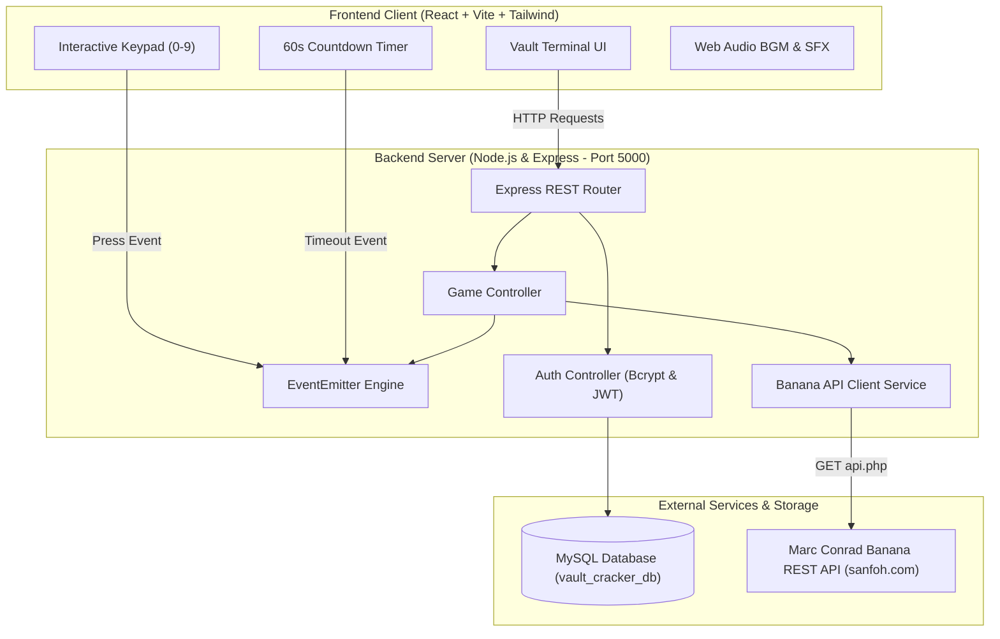
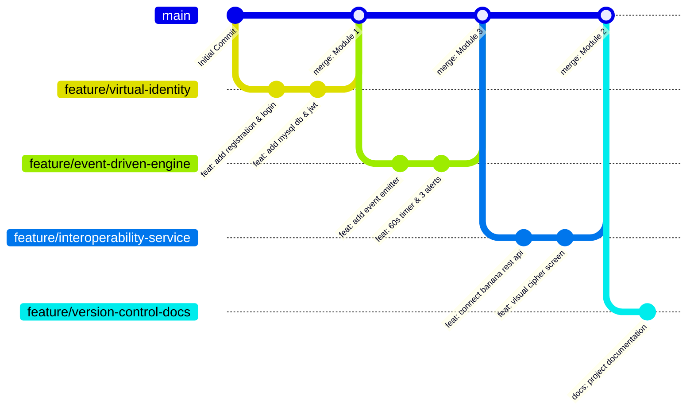

# 🏦 Vault Cracker // Cyber-Heist Web Application

Welcome to **Vault Cracker**, a full-stack cyber-heist web application where players take on the role of an operative infiltrating a high-security digital vault. 

This project was built to demonstrate four core software enterprise concepts:
1. **Virtual Identity Module** (Authentication & MySQL Database)
2. **Interoperability Module** (Integration with Marc Conrad's Banana REST API)
3. **Event-Driven Game Engine** (Countdown Timer, Keypad Events, and 3-Alert Security System)
4. **Version Control & Workflow** (Git Feature Branching Strategy)

---

## 🎯 The 4 Core Modules

### 1. Virtual Identity Module
- **Registration & Login**: Operatives can create an account with Full Name, Nick name (Call-sign), Email, and Password.
- **Password Security**: Passwords are encrypted using **Bcrypt** with a salt round of 10 before saving to MySQL.
- **Session Tokens**: Uses **JSON Web Tokens (JWT)** to keep the agent logged in securely.
- **MySQL Database**: Stores operative records in two relational tables: `agents` and `agent_stats`.

### 2. Interoperability Module
- **External REST API**: Communicates with **Marc Conrad's Banana REST API** (`https://marcconrad.com/uob/banana/api.php?out=json`).
- **Live Puzzle Retrieval**: Fetches a live visual arithmetic cipher image and its solution (0–9) dynamically.
- **Clean Configuration**: The API endpoint is configured via environment variables in `server/.env`.
- **Fail-Safe Fallback**: Includes a fallback mode so the game continues to work smoothly even if the external network is offline during an examination.

### 3. Event-Driven Game Engine
- **3 Progressive Levels**: The vault has 3 layers (Level 1, Level 2, Level 3). Solving all 3 layers successfully unlocks the vault.
- **60-Second Countdown Timer**: Every cipher puzzle has an active 60-second timer managed by event intervals.
- **Interactive Keypad**: Operatives can input single-digit codes (0–9) using the on-screen keypad or physical keyboard.
- **3-Alert Security Strike System**:
  - **Alert 1 (Strike 1)**: Wrong code or timer expiration triggers Alert 1 (Warning), resets the timer to 60s, and loads a new puzzle.
  - **Alert 2 (Strike 2 - Penalty)**: A second failure demotes the player by 1 level (e.g., Level 2 demotes to Level 1). A warning popup modal appears: *"1 CHANCE REMAINING BEFORE ARREST"*.
  - **Alert 3 (Strike 3 - Arrest)**: A third failure triggers maximum security lockdown, and the operative is arrested (Game Over).

### 4. Version Control & Git Workflow
- Developed using a clean **Feature Branching Workflow** where every module is developed on its own dedicated branch before merging to `main`:
  - `feature/virtual-identity` (Module 1)
  - `feature/interoperability-service` (Module 2)
  - `feature/event-driven-engine` (Module 3)
  - `feature/version-control-docs` (Module 4)

---

## 🏗️ System Architecture



---

## 🌿 Git Branching Strategy



---

## 📂 Project Structure

```text
vault-cracker-heist/
├── client/                     # Frontend Application
│   ├── src/
│   │   ├── components/         # UI Components
│   │   │   ├── LandingHero.jsx # Robber Heist Title Screen & BGM
│   │   │   ├── LoginForm.jsx   # Operative Login Form
│   │   │   ├── RegisterForm.jsx# Operative Registration Form
│   │   │   ├── Dashboard.jsx   # Welcome Operative & Vault Entrance
│   │   │   ├── VaultGame.jsx   # Banana Cipher & Interactive Keypad
│   │   │   ├── Navbar.jsx      # Header with SFX & Logout
│   │   │   └── AlertBanner.jsx # Notification Banners
│   │   ├── context/
│   │   │   └── AuthContext.jsx # Global User Authentication State
│   │   ├── utils/
│   │   │   └── audio.js        # BGM Player & Sound Effects
│   │   ├── App.jsx             # Main Router & View Switcher
│   │   ├── index.css           # Tailwind Styles
│   │   └── main.jsx
│   ├── package.json
│   └── vite.config.js          # Vite config with /api proxy (port 3000 -> 5000)
│
├── server/                     # Backend Application
│   ├── src/
│   │   ├── config/
│   │   │   └── db.js           # MySQL connection pool & auto-migrations
│   │   ├── controllers/
│   │   │   ├── authController.js# Registration, Login & Session Handlers
│   │   │   └── gameController.js# Mission Start & Answer Submission Logic
│   │   ├── events/
│   │   │   └── eventManager.js # Node.js EventEmitter (Timer & Alerts)
│   │   ├── middleware/
│   │   │   └── authMiddleware.js# JWT verification middleware
│   │   ├── routes/
│   │   │   ├── authRoutes.js   # /api/auth routes
│   │   │   └── gameRoutes.js   # /api/game routes
│   │   ├── services/
│   │   │   └── bananaApiService.js # External Banana REST API Service
│   │   └── server.js           # Express Application Entry (Port 5000)
│   ├── .env                    # Environment variables (DB & Banana API URL)
│   └── package.json
│
├── docs/
│   └── VIVA_GUIDE.md           # Quick Viva Examination Questions & Answers
├── package.json                # Root monorepo configuration
└── README.md                   # Main Project Documentation
```

---

## 🛠️ Tech Stack

- **Frontend**: React 18, Vite, Tailwind CSS, Lucide Icons
- **Backend**: Node.js, Express.js, Node.js EventEmitter
- **Database**: MySQL (using `mysql2/promise` connection pool)
- **Security**: Bcrypt (Password Hashing), JSON Web Tokens (JWT)
- **External Integration**: Marc Conrad's Banana REST API
- **Audio**: HTML5 Audio (BGM) & Web Audio API (SFX)

---

## 🚀 How to Run the Project

### Prerequisites
- [Node.js](https://nodejs.org/) (v18 or higher)
- [XAMPP](https://www.apachefriends.org/) (or any local MySQL service running on port 3306)

### Step 1: Clone the Repository
```bash
git clone https://github.com/Sandaru03/vault-cracker-heist.git
cd vault-cracker-heist
```

### Step 2: Install Dependencies
Install dependencies for both client and server:
```bash
npm install
cd server && npm install
cd ../client && npm install
cd ..
```

### Step 3: Configure Database & Environment
1. Start **Apache** and **MySQL** in your XAMPP Control Panel.
2. In `server/.env`, ensure your MySQL credentials match:
   ```env
   PORT=5000
   DB_HOST=localhost
   DB_USER=root
   DB_PASSWORD=
   DB_NAME=vault_cracker_db
   JWT_SECRET=cyber_vault_agent_secret_key_2026
   BANANA_API_URL=https://marcconrad.com/uob/banana/api.php?out=json
   ```
   *(Note: The server will automatically create the `vault_cracker_db` database and its tables on startup if they do not exist).*

### Step 4: Run the Application
From the root project folder, run both backend and frontend together with a single command:
```bash
npm run dev
```

- **Frontend**: `http://localhost:3000`
- **Backend API**: `http://localhost:5000`

---

## 📋 API Endpoints Summary

### Authentication Routes (`/api/auth`)
| Method | Endpoint | Description |
| :--- | :--- | :--- |
| `POST` | `/api/auth/register` | Register new agent, hash password, create database record |
| `POST` | `/api/auth/login` | Validate credentials, generate JWT session token |
| `GET` | `/api/auth/me` | Fetch authenticated operative details (Protected) |
| `POST` | `/api/auth/logout` | Terminate active session |

### Game Engine Routes (`/api/game`)
| Method | Endpoint | Description |
| :--- | :--- | :--- |
| `POST` | `/api/game/start` | Start mission, initialize Level 1, fetch first Banana puzzle |
| `POST` | `/api/game/submit` | Evaluate answer, manage 60s timer, handle Level progression & 3 Alerts |

---

## 📄 License
This project is developed for academic purposes as part of the Software Enterprise degree module.
